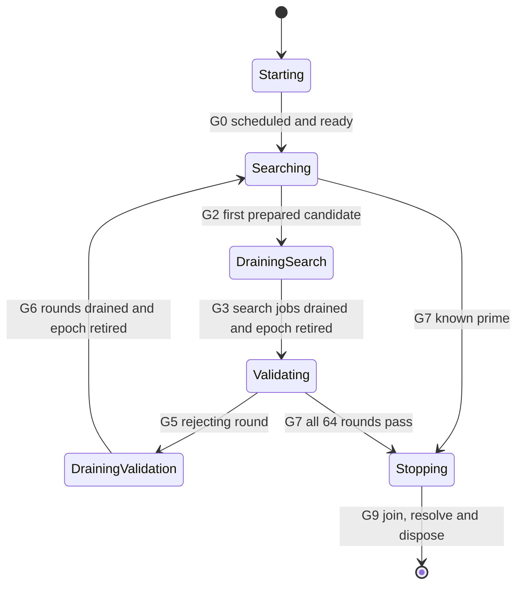

# Prime generation: implementation and performance baseline

This is the maintenance reference for `Gearbox.Cryptography.Prime` and the
cooperative implementation delivered on **2026-11-13**. The implementation
generates fresh candidates, shares the validation of one prepared candidate
across an operation's dedicated workers, and publishes only after the required
checks finish. The final implementation's measurements below are the baseline
for future optimizations. Preserve this dated snapshot and its raw data when
adding results for a later version.

Quick navigation: [APIs and routes](#public-api-and-execution-routes),
[sampling](#candidate-sampling-and-the-serial-search),
[mathematics](#mathematical-preparation-and-random-validation),
[worker protocol](#cooperative-worker-protocol),
[cancellation and cleanup](#cancellation-faults-and-completion),
[maintenance checks](#observation-and-maintenance-checks),
[final measurements](#preserved-final-baseline-2026-11-13), and
[future comparisons](#reproducing-and-extending-the-baseline).

## Source map

| Source | Responsibility |
| --- | --- |
| [Prime.cs](../src/Gearbox/Cryptography/Prime.cs) | Public APIs, route selection, candidate shaping, worker startup/loop, preparation, witness sampling, Miller–Rabin, Lucas–Selfridge, and mathematical helpers. |
| [PreparedCandidate.cs](../src/Gearbox/Cryptography/PreparedCandidate.cs) | Preparation outcomes and the immutable mathematical data shared by random rounds. |
| [PrimeGenerationContext.cs](../src/Gearbox/Cryptography/PrimeGenerationContext.cs) | Phases, epochs, tickets, atomic gates, admission/completion counts, transition ownership, publication, fault storage, and operation cleanup. |
| [ProcessorTopology.cs](../src/Gearbox/ProcessorTopology.cs) | Physical-core discovery, runtime processor limits, and fallback to one worker. |
| [PrimeTests.cs](../tests/Gearbox.Tests/Cryptography/PrimeTests.cs) | Mathematical, sampling, bit-length, API, and serial cancellation regressions. |
| [PrimeGenerationContextTests.cs](../tests/Gearbox.Tests/Cryptography/PrimeGenerationContextTests.cs) | Deterministic gate, stale-ticket, rejection, drain, retirement, and termination tests. |
| [PrimeParallelTests.cs](../tests/Gearbox.Tests/Cryptography/PrimeParallelTests.cs) | Sync/async worker integration, scheduling/initialization failures, witness resampling, worker reuse, observer faults, and outcome precedence. |

The original [implementation specification](cooperative-prime-validation-plan.md)
defines the acceptance contract. [Delivery evidence](prime-performance/delivery.md)
and [delivery-gates.json](prime-performance/delivery-gates.json) record D0–D7.

## Public API and execution routes

All four public methods accept an optional `CancellationToken`:

| Method | Behavior |
| --- | --- |
| `Generate(int bitLength, CancellationToken)` | Synchronously returns an exact-bit-length probable prime. |
| `GenerateAsync(int bitLength, CancellationToken)` | Returns a task for the same generation algorithm and result rules. |
| `IsProbablePrime(BigInteger candidate, CancellationToken)` | Serial probable-primality test; values below two return false. |
| `IsProbablePrimeAsync(BigInteger candidate, CancellationToken)` | Runs the serial test through its existing `Task.Run` wrapper. |

Generation rejects `bitLength < 2` synchronously, including on the async API.
Pre-canceled synchronous calls throw before allocation or worker initialization.
Pre-canceled async generation returns `Task.FromCanceled` with the caller token
before topology selection or worker initialization. Primality testing checks
cancellation before its small-value fast paths. Internal overloads validate
random-source delegates/factories for null and explicit worker counts for values
below one; these seams are used by deterministic tests and diagnostics.

`GetGenerationWorkerCount` chooses one worker below **512 bits**. At 512 bits and
above, it uses `ProcessorTopology.WorkerCount`. A selected count of one always
uses `SearchForPrime`, including on a single-core host or after topology fallback.
Serial async generation runs that serial search on the thread pool. Cooperative
generation runs only when the selected count exceeds one.

The topology budget is
`min(max(1, physicalCoreCount), max(1, Environment.ProcessorCount))`:

| Host | Discovery |
| --- | --- |
| Windows | `GetLogicalProcessorInformationEx(RelationProcessorCore)`; count core records regardless of SMT flags or processor groups. Retry a changing buffer size up to three reads and validate record bounds. |
| Linux | Read online CPUs in `/sys/devices/system/cpu`; deduplicate `(physical_package_id, core_id)` pairs. |
| macOS | `sysctlbyname("hw.physicalcpu")`. |
| Unsupported host or supported discovery failure | One worker. Expected I/O, permission, unsupported/native-entry-point, format, and overflow failures fall back to one. |

Physical-core discovery is cached through `Lazy<int>`; worker selection applies
the runtime processor limit. This is a thread-count budget, with placement left
to the operating-system scheduler. Each generation call owns its pool and budget.
Concurrent calls have independent candidates, epochs, tickets, failures and
results; there is no shared scheduler or budget that arbitrates between calls.

## Candidate sampling and the serial search

The default random source is `RandomNumberGenerator.Fill`. Internal
`RandomByteFiller` delegates fill a supplied span and permit deterministic tests.
The cooperative random-source factory is called once per initialized worker;
that delegate is reused for both candidate and witness draws.

For bit length `b`, the candidate buffer has `((b - 1) / 8) + 1` bytes. Bytes are
interpreted as an **unsigned, big-endian** `BigInteger`. For each candidate:

1. Fill the whole buffer with fresh random bytes and check cancellation.
2. Let `usedBits = ((b - 1) % 8) + 1`. Mask the first byte with
   `(1 << usedBits) - 1` and set bit `usedBits - 1` in that byte.
3. If `b > 2`, set the low bit of the last byte so the candidate is odd.
4. Construct the integer and run preparation.

At two bits, step 3 is omitted. Masking and setting the high bit maps the random
byte equally to 2 or 3; the exhaustive test produces 128 of each across all 256
byte values. At larger sizes, shaping uniformly samples the exact-bit-length odd
candidate space. Rejection always leads to another fresh draw. The implementation
does not increment a rejected candidate or search neighboring odd integers.

`SearchForPrime` repeats this sampling and the full serial primality core until a
candidate passes. The serial core and cooperative workers share preparation and
the random-round helper. A serial accepted candidate above the small-prime list
consumes one candidate draw and 64 witness draws when no rejection resampling is
needed; rejected candidates and out-of-range witness draws add their own draws.
Existing deterministic draw order is preserved.

## Mathematical preparation and random validation

### Preparation outcomes and check order

`PrepareCandidate` consumes **no witness randomness**. It performs the following
checks in order and returns an outcome:

| Check | Result |
| --- | --- |
| `n < 2` | `Composite`. |
| `n == 2` or `n == 3` | `KnownPrime`. |
| `n.IsEven` | `Composite`. |
| Ascending `SmallPrimes` list, every prime from 3 through 997 | Equality returns `KnownPrime`; divisibility returns `Composite`. A separate `BigInteger` remainder is currently computed for each prime visited. |
| Integer perfect-square check | `Composite` for a square. |
| Decompose `n - 1 = 2^s * d`, with odd `d`, and run base-2 strong Miller–Rabin | `Composite` on rejection. |
| Strong Lucas–Selfridge | `Composite` on rejection. |
| All preceding checks pass | `NeedsRandomRounds`, with immutable `PreparedCandidate` data. |

`KnownPrime` uses the normal result gate without inventing random rounds. The
other accepted candidates must pass all **64 additional random Miller–Rabin
rounds**, after the deterministic base-2 round and Lucas check. Trial division is
currently ungrouped: the final profiling measurements did not open the grouped
filter's 5% CPU gate.

`PreparedCandidate` stores:

| Field | Meaning |
| --- | --- |
| `Candidate` | `n`. |
| `OddPart`, `PowerOfTwo` | `d`, `s` from `n - 1 = 2^s * d`; calculated once and reused by every random round. |
| `WitnessRange` | `n - 3`, the exclusive upper bound for a sampled witness offset. |
| `WitnessByteCount` | Byte length of the unsigned, big-endian representation of `n - 4`. |
| `HighByteMask` | Mask covering the used bits of that representation's first byte. |

The helper derives the byte count/mask from a temporary representation of `n - 4`
and clears that temporary array. `BigInteger` values and the record's properties
are immutable; random-round workers share this data without modifying it.

### Witness sampling and Miller–Rabin

`ValidateRandomRound` calls
`SampleBelow(WitnessRange, buffer, HighByteMask, filler, token) + 2`.
`SampleBelow` fills the whole buffer, masks only unused high bits, interprets the
buffer as unsigned/big-endian, and retries until the offset is below `n - 3`.
Consequently witnesses are independent uniform draws from **[2, n - 2]**. It does
not force a witness's highest bit, reduce a random integer modulo the range, or
require distinct witnesses. Repeated witnesses are valid independent draws.
Resampling uses the already admitted round; it does not claim another index.

For a witness `a`, `PassesMillerRabinRound` computes
`x = BigInteger.ModPow(a, d, n)`. It passes if `x` is 1 or `n - 1`. Otherwise it
performs up to `s - 1` modular squarings, passing on `n - 1`, rejecting an early
return to 1, and rejecting if the sequence never reaches `n - 1`. Modular
exponentiation is the framework `BigInteger.ModPow`; there is no custom exponentiator.

For each fixed composite, the false-acceptance bound for the 64 independent random
rounds is `(1/4)^64 = 2^-128`. This is a fixed-composite testing bound, rather than
a primality proof or a new bound on the output distribution of repeated generation.

### Square, Lucas and supporting helpers

`IsPerfectSquare` uses integer Newton iteration. It starts at
`2^ceil(bitLength(n)/2)`, repeatedly calculates `(root + n/root) / 2`, and stops
when the next estimate no longer decreases. It then checks `root * root == n`.
Squares are rejected before the Selfridge discriminant search, which otherwise
cannot find a Jacobi symbol of -1 for a square.

`PassesStrongLucas` searches discriminants `D = 5, -7, 9, -11, ...` until
`JacobiSymbol(D, n) == -1`. A zero symbol with a nontrivial `gcd(D, n)` rejects the
candidate. It uses Selfridge parameters `P = 1`, `Q = (1 - D)/4`, requires
`gcd(Q, n) == 1`, and decomposes `n + 1 = 2^t * e` with odd `e`.

The binary sequence calculation tracks `U`, `V`, and powers of `Q`, using doubling
identities `U_(2k) = U_k V_k` and `V_(2k) = V_k^2 - 2 Q^k` modulo `n`. Set bits
advance by one using the previous doubled `U`/`V` values and modular halving.
The strong test accepts `U_e == 0`, `V_e == 0`, or a zero `V_(2^r e)` for
`1 <= r < t`. `Normalize` keeps modular residues nonnegative; `HalveModulo` adds
the odd modulus before dividing an odd residue by two. `JacobiSymbol` strips
powers of two with the modulo-8 sign rule, swaps operands with quadratic
reciprocity, and returns zero when the final gcd is not one. Component-only
Miller–Rabin/Lucas/Jacobi entry points are internal test seams.

## Cooperative worker protocol

### Startup and ownership

The context starts in `Starting` and constructs `SearchEpoch` ID 1 before any
worker is scheduled. Scheduling creates only the selected number of tasks, using
`TaskCreationOptions.LongRunning`, `TaskScheduler.Default` and
`CancellationToken.None` for scheduling. Internal overloads permit an explicit
scheduler for tests. There are no tasks per candidate, round or phase.

Each worker checks operation cancellation, initializes its random-source delegate
and private candidate buffer, and reports ready once. The coordinator marks
`scheduledAll` only after every configured task was successfully scheduled.
Either the coordinator or last ready worker can open startup. All readiness and
scheduling predicates must hold together; workers cannot draw candidates before
that gate. A failed initialization or partial scheduling immediately stops the
operation. Unscheduled task-array slots remain `Task.CompletedTask`, so joining
the actually started workers never waits for nonexistent participants.

Each worker owns its candidate and witness arrays exclusively. Witness storage is
allocated on demand, reused, and cleared/replaced if the required
`WitnessByteCount` changes. Cooperative candidate and witness buffers are cleared
in the job's `finally` path and again during worker cleanup. Serial buffers are
cleared when their owning search or test ends.

### Phases and atomic gates

One private **object monitor** protects phases, current epoch, pending candidate,
ready/scheduled state, per-worker active slots, round counts, result and failure.
`Monitor.Wait` runs in a predicate loop on idle dedicated workers;
`Monitor.PulseAll` announces relevant changes. Waking up grants no admission.
Workers recheck running state and the applicable phase/epoch gate under the lock.
An object monitor is required here; replacing it with a `System.Threading.Lock`
scope would make `Monitor.Wait/PulseAll` use the wrong synchronization mechanism.

Randomness, mathematics, observer callbacks, cancellation, epoch construction and
disposal run **outside** the monitor. The check and state/accounting update for
each gate remain one atomic monitor operation.



Caller cancellation or an unexpected fault can enter `Stopping` from any live
phase through G8. `Stopping` never reopens a work phase. In the table, **running**
means the phase is not `Stopping`, the operation token is not canceled, no result
is published, and no unexpected failure has been recorded.

| Gate | Predicate and atomic consequence |
| --- | --- |
| G0 startup | `Starting`, all configured tasks scheduled, every worker ready once, and running: open the first search epoch exactly once. |
| G1 search admission | `Searching`, current open search epoch, idle worker, and running: issue a new ticket and increment `ActiveJobs`. |
| G2 promotion | A matching current search ticket supplies `NeedsRandomRounds` while `Searching` and running: retain the first prepared candidate, enter `DrainingSearch`, and elect one close owner. Later candidates cannot replace it. |
| G3 validation entry | `DrainingSearch`, zero admitted search jobs, close cancellation returned, pending candidate, and running: elect one transition owner; retire/create outside the lock, then recheck and install the validation epoch. |
| G4 round admission | `Validating`, current nonrejected epoch, `NextRoundIndex < 64`, idle worker, and running: claim one distinct index, mark its state active, and increment `ActiveRounds`. |
| G5 rejection | A matching current active round reports false while `Validating`, not yet rejected, and running: mark rejection, enter `DrainingValidation`, and elect one close owner. |
| G6 search restart | `DrainingValidation`, rejected, zero active rounds, close cancellation returned, and running: retire/create through one transition owner, recheck, install a fresh search epoch, and clear the pending candidate. |
| G7 publication | While running, publish a known prime from a matching current search ticket, or a current nonrejected validation candidate with all 64 passing completions and zero active rounds. Store one result and enter `Stopping`. |
| G8 termination | Caller cancellation, unexpected failure, or publication closes admission, enters `Stopping`, wakes waiters and signals operation completion. |
| G9 public completion | After all started tasks join, require `Stopping`, no active tickets and no transition owner. Select the final outcome, dispose context dependencies, then complete the public call/task. |

### Epochs, admission tickets and the 64-round invariant

Every epoch has an immutable ID and its own cancellation source linked to the
operation token. ID 1 is reserved at startup; successor IDs are reserved under
the monitor and increase monotonically. A canceled transition can leave an ID
gap. Canceled sources and round counters are never reset or reused.

A `SearchEpoch` counts admitted jobs. One search job is one fresh candidate draw,
shaping, and preparation. Composite completion releases that job so the worker
can seek another admission. The first promotable candidate closes search
admission; other already admitted jobs must finish or observe epoch cancellation.
A later result from that epoch cannot change the pending candidate or publish a
known prime after promotion.

A `ValidationEpoch` owns the prepared candidate, `NextRoundIndex`, `ActiveRounds`,
`PassedRounds`, `Rejected`, and a fixed 64-entry `RoundStates` array:

| State byte | Meaning |
| ---: | --- |
| 0 | Unclaimed. |
| 1 | Active. |
| 2 | Passed. |
| 3 | Rejected or canceled. |

The production round counter is monitor-protected, not an independent
`Interlocked` counter. Index allocation, phase validation, active-slot identity
and active-round accounting change together. Indices are exactly 0–63. If all
indices are claimed while some rounds remain active, idle workers wait: they
cannot exit, declare success, or begin a new search. Completion of index 63 has
no special publication privilege.

`PrimeAdmissionTicket` is a value containing the epoch reference, worker index,
fresh admission ID and round index (or -1 for a search job). Every worker has at
most one active ticket. `CompleteSearch`/`CompleteRound` first require an exact
match with that active slot. Duplicate, forged or old reports cannot release a
newer job or change its epoch's counts/result. Matching completions release their
own active slot/count even during draining or stopping; mathematical results in
those phases cannot publish, initiate another rejection, or reopen admission.

Workers report through a `finally`-protected path. For canceled rounds, the
nullable pass result remains null and does not increment `PassedRounds`.
Acceptance requires 64 distinct passing completions and zero active rounds in a
current, nonrejected validation epoch while the operation is running.

### Close, cancel, drain, retire, reopen

Promotion and rejection both use this ordering:

1. Under the monitor, close admission, enter the draining phase, and elect one
   close owner.
2. Outside the monitor, cancel the old epoch token. Admitted work stops at its
   existing cancellation checkpoints.
3. Under the monitor, record that the cancellation call has returned and wake
   waiters. Zero active work alone is insufficient before this flag is set.
4. Once actual admitted work has drained, elect one transition owner, reserve a
   successor ID, and keep admission closed.
5. Outside the monitor, dispose the old linked source and construct the successor.
6. Reenter the monitor and recheck old-epoch identity, draining phase and running
   state. Install the successor only if termination has not won the race.
7. Dispose any uninstalled successor outside the monitor and release transition
   ownership.

Both a completing worker and the returning close owner can notice a drained
epoch; the transition-owner flag prevents duplicate successors. Draining counts
jobs actually admitted, rather than waiting for a fixed worker phase barrier.
Idle workers and unscheduled/uninitialized slots do not contribute active jobs.
The operation's `Completed` event signals termination only; handoffs never set it.

## Cancellation, faults and completion

Each job saves **its ticket's epoch token** before doing work. An
`OperationCanceledException` is expected job termination only when it carries
that saved token and the token is canceled. Search handoff or candidate rejection
returns the worker to admission; it does not fault or terminate generation.
Initializer cancellation is classified against the operation token. An unrelated
cancellation exception is recorded as an unexpected fault; cooperative async
generation uses `TaskCompletionSource.SetException` so it remains faulted when
the caller token is not canceled.

A false Miller–Rabin result rejects the candidate normally. Random-source,
scheduler, initializer, mathematics, observer and retirement exceptions save the
first `ExceptionDispatchInfo` and stop peers. A genuine fault after provisional
result publication is still retained. Operation cancellation callbacks use the
monitor only to close gates/change phase/wake waiters; event signaling and calls
to `CancellationTokenSource.Cancel` occur outside it.

Cancellation is cooperative. Checks surround fills, sampling attempts and costly
mathematical steps/loop iterations. `BigInteger.ModPow` cannot be interrupted, so
handoff, rejection or cancellation waits for executing calls and their admitted
jobs to finish before retirement or public completion.

The synchronous coordinator waits on `Completed` and then joins all started
tasks with `Task.WhenAll(...).GetAwaiter().GetResult()`. The async coordinator
awaits the same tasks with `ConfigureAwait(false)`; it does not allocate a
blocking coordinator task. Its result task uses
`RunContinuationsAsynchronously`.

After joining, `GetResult` verifies the drained stopping state and selects the
outcome in this order: caller cancellation (preserving the caller token), saved
unexpected fault (preserving the exception/stack), published prime. A caller
cancellation arriving after the final cancellation check can arrive after a
successful result has been selected. Before the public call/task completes,
context disposal waits for its cancellation registration, disposes the final
epoch/source, and then disposes the operation source and completion event.
Worker cleanup and transition ownership have already finished at that point.

## Observation and maintenance checks

`IPrimeGenerationObserver` is internal and optional; public APIs supply no
observer. It reports `WorkerReady`, `SearchJobAdmitted`, `RoundAdmitted`,
`PhaseChanged` (with transition sequence), and `EpochRetiring`. Callbacks run
outside the monitor and may coordinate bounded tests, but never replace
mathematical results or publish primes. Callback failures stop the operation.
Phase delivery can be reordered across threads: use transition sequence numbers
or locked snapshots, rather than callback arrival order.

When modifying this code, preserve exact candidate/witness sampling, the
preparation order, 64 independent rounds, matching-ticket accounting, monotonic
termination, the close/cancel/drain/retire order, and joining/registration cleanup.
Tests should coordinate with events/observers and bounded deadlines. A worker's
completion is evidence of operation exit, not candidate promotion. Startup tests
must wait for readiness rather than a candidate draw behind G0.

Context tests can supply prepared data for composite 2047 and exercise an actual
rejecting witness 3; they do not claim it passes preparation. Full worker tests
follow genuine preparation. The delivered suite covers simultaneous promotion,
held cancellation/retirement, out-of-order rounds, exhausted indices, duplicate
and stale reports, repeated epochs, every work-phase cancellation, source and
observer faults, partial startup, concurrent calls, and provisional-result races.
It includes 100 bounded rejection/handoff/stale-report iterations and 100 bounded
rejection-versus-peer-completion races.

The recorded final Release suite passed **1,255 tests, zero failures and zero
skips**; [exact counters and timestamps](prime-performance/release-test-counters.json)
are preserved. All four public signatures matched the previous implementation.
Use the following checks after an implementation change:

```powershell
dotnet build Solution.slnx -c Release
dotnet test Solution.slnx -c Release --no-restore
dotnet test Solution.slnx -c Release --filter 'FullyQualifiedName~Cryptography.Prime'
```

Candidate batches, neighboring-odd searches, SIMD sieving, changing witness
counts, custom modular exponentiation, and topology changes were outside this
delivery. Revisit an optimization with a defined scope, correctness evidence and
measurements against the final baseline below.

## Preserved final baseline: 2026-11-13

### Host, version and measurement definitions

| Item | Recorded value |
| --- | --- |
| CPU | Intel Core i9-10900, 10 physical cores / 20 logical processors. |
| OS / architecture | Windows kernel version 10.0.26300, x64. |
| SDK / target / runtime | SDK 11.0.100; `net10.0`; actual runtime **.NET 10.0.15**. |
| Build | Release; default runtime settings from the saved harness. |
| Worker counts | Physical-worker limit 10; actual workers 1 at 256 bits, 10 at 512/1024/2048/4096 bits. |
| Final library SHA256 | `2E580F147F41F47978C4D4C48108A9DF8D7E462D6776AADC34449B72167512E2`. |
| Source provenance | Delivery working tree based on `e2b8ac300229756fbd30897b83765829afb8d6c1`; that starting commit is the older candidate-race implementation, not the final cooperative source revision. |
| Preserved final executable | `.artifacts/prime-cooperative/harness/Gearbox.Tests.dll`, with its copied `Gearbox.dll` and runtime/dependency files. Local artifacts are ignored; the tables, raw CSVs, exact JSON, and harness source are durable repository documents. |
| Native coverage | Windows topology and CPU profiling executed. Linux/macOS native behavior was not executed; existing parser/limit/fallback tests were included in the suite. |

The end-to-end comparison used **three sessions, 20 recorded calls per mode and
bit length per session**, in isolated processes with no active observer or test
suite. Each process warmed one complete generation before measurement. Sizes
were 256, 512, 1024, 2048 and 4096 bits. Sessions 1/3 ran the older candidate race
first; session 2 reversed the order. The final cooperative calls total **300
recorded generations**, including 60 serial 256-bit controls.

Elapsed time uses `Stopwatch` around `Prime.Generate`, including search, drains,
worker joining and context cleanup. Managed allocations use process-wide
`GC.GetTotalAllocatedBytes(true)` differences and include the harness's small
per-measurement managed overhead. CPU uses `Process.TotalProcessorTime`
differences across all process threads; parallel CPU milliseconds can exceed
elapsed milliseconds. CSV writing/bit-length verification happen after elapsed
timing. CPU accounting has the host's process-time resolution (many readings are
multiples of 15.625 ms).

Median is the arithmetic mean of the middle two observations for 20 samples.
Sampled p95 uses nearest rank `ceil(0.95 * N)` (the 19th sorted observation at
N = 20). Five-sample diagnostic p95 is therefore the maximum observation.
Allocation figures below are exact median **bytes**; divide by 1,048,576 for MiB.
Latency medians are printed to five decimals, reflecting averages of the raw
four-decimal measurements; exact source values remain in the linked files.

### All final end-to-end session measurements

These tables contain only the **final cooperative implementation**, including
its unchanged serial route at 256 bits. Each bit-length link opens all 20 raw
observations. [results.json](prime-performance/results.json) preserves exact
summaries for every session and both comparison modes.

#### Session 1

| Bits / raw samples | Actual workers | Calls | Median elapsed ms | Sampled p95 ms | Median allocated bytes | Median CPU ms |
| ---: | ---: | ---: | ---: | ---: | ---: | ---: |
| [256](prime-performance/samples/session-1-cooperative-256.csv) | 1 | 20 | 17.96605 | 34.2010 | 249220 | 15.6250 |
| [512](prime-performance/samples/session-1-cooperative-512.csv) | 10 | 20 | 21.88405 | 48.7413 | 1126924 | 195.3125 |
| [1024](prime-performance/samples/session-1-cooperative-1024.csv) | 10 | 20 | 72.85945 | 142.0630 | 3355560 | 632.8125 |
| [2048](prime-performance/samples/session-1-cooperative-2048.csv) | 10 | 20 | 658.08060 | 1006.7618 | 11097352 | 6351.5625 |
| [4096](prime-performance/samples/session-1-cooperative-4096.csv) | 10 | 20 | 5520.59235 | 10551.1746 | 39050444 | 53500.0000 |

#### Session 2

| Bits / raw samples | Actual workers | Calls | Median elapsed ms | Sampled p95 ms | Median allocated bytes | Median CPU ms |
| ---: | ---: | ---: | ---: | ---: | ---: | ---: |
| [256](prime-performance/samples/session-2-cooperative-256.csv) | 1 | 20 | 15.64405 | 27.7192 | 258240 | 15.6250 |
| [512](prime-performance/samples/session-2-cooperative-512.csv) | 10 | 20 | 20.08085 | 37.0676 | 1008308 | 156.2500 |
| [1024](prime-performance/samples/session-2-cooperative-1024.csv) | 10 | 20 | 85.79365 | 148.2553 | 3418780 | 781.2500 |
| [2048](prime-performance/samples/session-2-cooperative-2048.csv) | 10 | 20 | 587.89545 | 1348.2786 | 10561168 | 5640.6250 |
| [4096](prime-performance/samples/session-2-cooperative-4096.csv) | 10 | 20 | 5722.01960 | 13142.9404 | 40534192 | 55500.0000 |

#### Session 3

| Bits / raw samples | Actual workers | Calls | Median elapsed ms | Sampled p95 ms | Median allocated bytes | Median CPU ms |
| ---: | ---: | ---: | ---: | ---: | ---: | ---: |
| [256](prime-performance/samples/session-3-cooperative-256.csv) | 1 | 20 | 16.05360 | 21.7530 | 238104 | 15.6250 |
| [512](prime-performance/samples/session-3-cooperative-512.csv) | 10 | 20 | 24.46840 | 56.8606 | 1043952 | 296.8750 |
| [1024](prime-performance/samples/session-3-cooperative-1024.csv) | 10 | 20 | 88.63105 | 167.4960 | 4160784 | 828.1250 |
| [2048](prime-performance/samples/session-3-cooperative-2048.csv) | 10 | 20 | 713.47595 | 1202.6530 | 10802100 | 6882.8125 |
| [4096](prime-performance/samples/session-3-cooperative-4096.csv) | 10 | 20 | 6267.42160 | 15533.0141 | 42600064 | 60765.6250 |

The 256-bit timings vary with fresh random search even though the route is
identical. The deterministic 256-bit control independently verifies the serial
route and the same 65 draws for the known prime `2^256 - 189`. Treat route/draw
behavior and repeated comparisons as the serial regression evidence.

The historical [comparison tables](prime-performance/measurements.md) retain
every candidate-race result alongside these final results. The cooperative
delivery passed all four original conditions in **all three sessions**: median
latency at most 80% of the old race at both 2048/4096 bits; p95 no worse at those
sizes; median allocations no greater at those sizes; and median latency no more
than 110% of the old race at both 512/1024 bits. These are the delivery's original
acceptance conditions, not an automatic requirement that every future
optimization improve the final implementation by another 20%.

### All prepared-prime validation measurements

These separate diagnostic runs use known Mersenne primes `2^p - 1` with actual
bit lengths **521, 1279, 2203 and 4253**. Each mode uses identical prepared values;
preparation and dedicated-thread startup precede timing. One warmed diagnostic
pool is reused for five recorded sequences of exactly 64 random rounds. Serial
uses one worker; shared uses ten. The diagnostic distributes helper calls using
its own barrier/counter harness; production round admission remains the context
monitor protocol described above.

These timings isolate round distribution and are not end-to-end
`IsProbablePrime` or random-generation timings. Every row links its five raw
observations, including CPU time and allocations.

| Actual bits / raw samples | Mode | Workers | Sequences | Median elapsed ms | Sampled p95 ms | Median allocated bytes | Median CPU ms |
| ---: | --- | ---: | ---: | ---: | ---: | ---: | ---: |
| [521](prime-performance/diagnostics/prepared-serial-521.csv) | serial | 1 | 5 | 52.79070 | 57.6591 | 19264 | 62.5000 |
| [521](prime-performance/diagnostics/prepared-shared-521.csv) | shared | 10 | 5 | 8.85130 | 9.4488 | 18112 | 156.2500 |
| [1279](prime-performance/diagnostics/prepared-serial-1279.csv) | serial | 1 | 5 | 537.93300 | 541.9521 | 35760 | 531.2500 |
| [1279](prime-performance/diagnostics/prepared-shared-1279.csv) | shared | 10 | 5 | 84.10950 | 90.4315 | 34632 | 796.8750 |
| [2203](prime-performance/diagnostics/prepared-serial-2203.csv) | serial | 1 | 5 | 2129.67960 | 2135.0650 | 57192 | 2125.0000 |
| [2203](prime-performance/diagnostics/prepared-shared-2203.csv) | shared | 10 | 5 | 284.53290 | 294.6903 | 59624 | 2640.6250 |
| [4253](prime-performance/diagnostics/prepared-serial-4253.csv) | serial | 1 | 5 | 12459.86030 | 12534.5740 | 110920 | 12453.1250 |
| [4253](prime-performance/diagnostics/prepared-shared-4253.csv) | shared | 10 | 5 | 2059.62470 | 2186.4933 | 113160 | 19359.3750 |

### All phase timing measurements

Five further observed generation calls at each size record the search/preparation
interval, handoff/drain, validation, stop/cleanup and full operation time. These
use callback timestamps outside the monitor, ordered by transition sequence;
they are approximate phase diagnostics collected separately from the principal
benchmark. Startup is included in total elapsed time but has no separate CSV
column. Medians of individual intervals need not sum to the median total.

| Bits / raw samples | Search/preparation ms | Handoff/drain ms | Validation ms | Stop/cleanup ms | Total ms |
| ---: | ---: | ---: | ---: | ---: | ---: |
| [2048](prime-performance/diagnostics/phases-2048.csv) | 656.13440 | 25.99330 | 225.52310 | 0.07950 | 904.61190 |
| [4096](prime-performance/diagnostics/phases-4096.csv) | 4579.88880 | 154.32430 | 1458.16040 | 0.11920 | 6194.26260 |

All ten individual phase observations are preserved here and in the source CSVs:

| Bits | Sample (0-based) | Search/preparation ms | Handoff/drain ms | Validation ms | Stop/cleanup ms | Total ms |
| ---: | ---: | ---: | ---: | ---: | ---: | ---: |
| 2048 | 0 | 508.2906 | 20.3902 | 245.9082 | 0.0790 | 775.9572 |
| 2048 | 1 | 871.8580 | 25.2910 | 225.5231 | 0.0877 | 1123.8304 |
| 2048 | 2 | 204.7213 | 29.8690 | 234.8844 | 0.0795 | 470.4785 |
| 2048 | 3 | 682.9216 | 27.6860 | 217.7404 | 0.1000 | 929.4165 |
| 2048 | 4 | 656.1344 | 25.9933 | 221.4588 | 0.0636 | 904.6119 |
| 4096 | 0 | 4739.7149 | 133.2581 | 1466.7509 | 0.1521 | 6341.4955 |
| 4096 | 1 | 4539.2538 | 154.3243 | 1453.6546 | 0.1060 | 6148.0866 |
| 4096 | 2 | 4579.8888 | 155.4671 | 1457.9814 | 0.1192 | 6194.2626 |
| 4096 | 3 | 9693.6571 | 149.8627 | 1458.1604 | 0.1425 | 11302.8423 |
| 4096 | 4 | 4100.7381 | 177.3530 | 1461.5460 | 0.1149 | 5740.6264 |

### All final native CPU-profile measurements and filter decision

The final Windows recordings use native sampled CPU stacks plus process/thread,
module and CLR loader/JIT method events. The minimal
[GearboxMethods.wprp](prime-performance/GearboxMethods.wprp) uses its own WPR
instance, skips dynamic PDB generation and records no heap snapshot or thread-time
workload. The analyzer resolves managed method stacks, selects the isolated
benchmark's `dotnet` CPU samples, and rejects traces with lost events. There must
be no other `dotnet` workload in the recording interval because that process-name
filter would include it.

Each workload warms one generation and records five more calls. CPU sample
counts include the complete traced benchmark process, including warmup; the
instrumented workload table summarizes only the five recorded calls. The profile
metrics and folded sample stacks are linked in each bit-length row.

| Bits / profile stacks | Total CPU samples | Preparation samples (inclusive) | Random-round samples | Filter upper-bound samples | Missing stacks | Filter share upper bound | Lost events |
| ---: | ---: | ---: | ---: | ---: | ---: | ---: | ---: |
| [2048](prime-performance/diagnostics/cpu-profile-2048.json) | 40872 | 29212 | 11209 | 123 | 0 | 0.300940% | 0 |
| [4096](prime-performance/diagnostics/cpu-profile-4096.json) | 417251 | 332112 | 84235 | 402 | 2 | 0.096824% | 0 |

The filter numerator conservatively includes all direct preparation work outside
the square, decomposition, Miller–Rabin and Lucas helpers, including trial
division, comparisons and preparation metadata. Missing stacks are charged to
that numerator too: `100 * (filterUpperBoundSamples + missingStacks) / totalSamples`.
It is an upper bound on the **sampled share**, not an exact separately timed
trial-division percentage. Both values are below 5%, so grouped filtering was
**skipped** and is absent from the final implementation.

Initial Windows preset captures dropped events and were discarded. Only these
zero-loss final recordings are baseline evidence.

The instrumented workload also recorded these generation measurements; keep them
separate from the uninstrumented end-to-end baseline:

| Bits / raw samples | Workers | Calls | Median elapsed ms | Sampled p95 ms | Median allocated bytes | Median CPU ms |
| ---: | ---: | ---: | ---: | ---: | ---: | ---: |
| [2048](prime-performance/diagnostics/cpu-workload-2048.csv) | 10 | 5 | 666.41400 | 1357.5936 | 11460240 | 6421.8750 |
| [4096](prime-performance/diagnostics/cpu-workload-4096.csv) | 10 | 5 | 6802.02620 | 11001.8021 | 42875520 | 66406.2500 |
